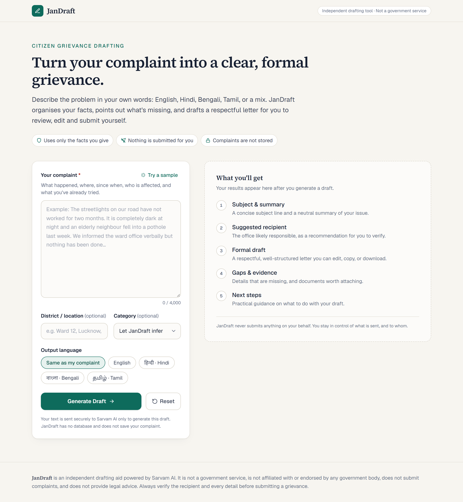
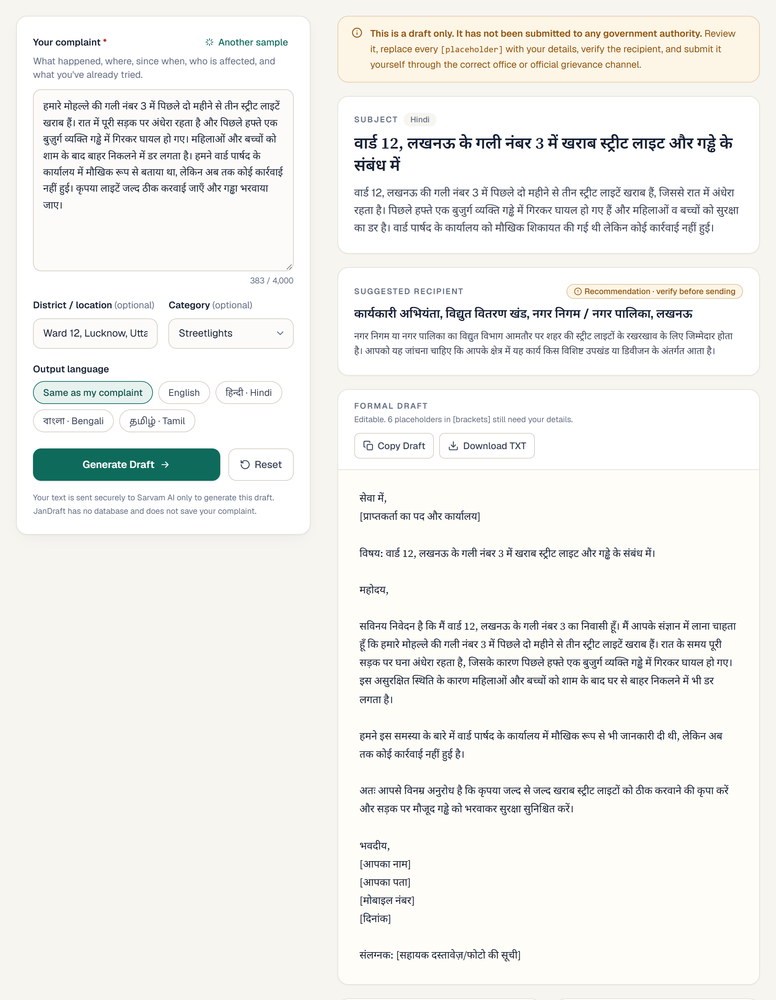
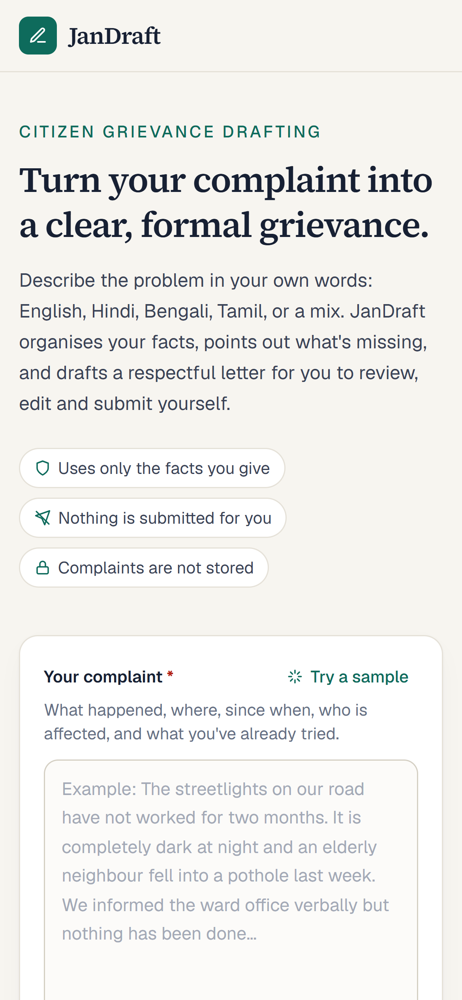
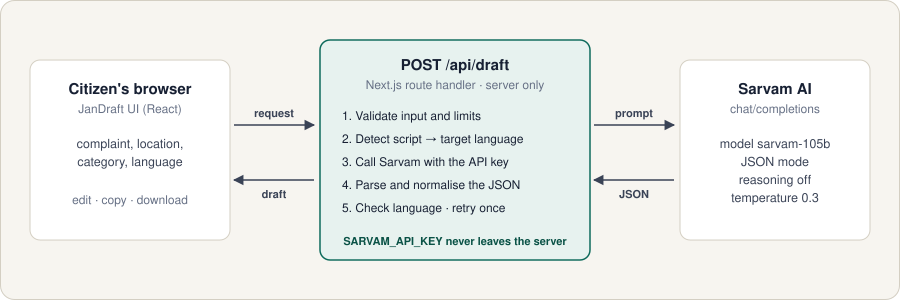

<div align="center">

# JanDraft

**Turn an informal complaint into a clear, formal civic grievance, in your language.**

A multilingual grievance drafting assistant for Indian citizens, powered by [Sarvam AI](https://www.sarvam.ai/).

<a href="https://jandraft-sarvam.vercel.app"></a>

**Live demo: [jandraft-sarvam.vercel.app](https://jandraft-sarvam.vercel.app)**


<br><br>

</div>



---

## The problem

Many citizens know exactly what is wrong (no water for three weeks, broken streetlights, ration not given) but find it hard to write a formal complaint that an office will act on. They may not know the formal register, which office is responsible, or which details and documents to include. Many are more comfortable writing in Hindi, Bengali, Tamil or Hinglish than formal English.

## What JanDraft does

You describe the problem in your own words. JanDraft returns:

| Section | What you get |
| --- | --- |
| **Subject & summary** | A concise subject line and a neutral two or three sentence summary |
| **Suggested recipient** | The office likely to be responsible, clearly labelled as a *recommendation to verify*, with the reasoning |
| **Formal draft** | A complete, respectful letter you can **edit**, **copy**, or **download as .txt** |
| **Key facts** | Only the facts you actually stated |
| **Missing information** | Details that would strengthen the grievance (dates, landmarks, number affected, earlier complaints) |
| **Evidence checklist** | Photos, receipts and records worth attaching, with checkboxes |
| **Next steps** | Practical guidance: verify the office, keep a copy, ask for an acknowledgement number |

**Languages:** English · हिन्दी Hindi · বাংলা Bengali · தமிழ் Tamil, or *same as the complaint* (Hinglish input produces Hindi in Devanagari).

<table>
  <tr>
    <td width="72%"></td>
    <td width="28%"></td>
  </tr>
  <tr>
    <td align="center"><sub>Hindi complaint → formal Hindi draft, with the recipient marked as a recommendation</sub></td>
    <td align="center"><sub>Responsive mobile layout</sub></td>
  </tr>
</table>

## Built to be trustworthy

JanDraft is designed as a careful civic tool, not a chatbot:

- **No invented facts.** The model is told never to invent dates, names, addresses, laws, phone numbers, URLs, reference numbers or amounts. Anything missing becomes a visible `[placeholder]` and is listed under *Missing information*.
- **Never claims submission.** Every result says the draft *has not been submitted to any government authority*. JanDraft cannot submit anything.
- **Recipient is a recommendation.** It is a designation or office type only (never a person's name or contact details), with a "verify before sending" label.
- **No government branding.** There are no logos, seals or claims of affiliation. The footer states that it is an independent tool.
- **Privacy.** There is no database and no accounts. The complaint is sent to Sarvam AI only to generate the draft and is never stored or logged. The server logs only HTTP status codes.
- **The key stays on the server.** `SARVAM_API_KEY` is read only inside the API route and never reaches the browser bundle (verified by searching the build output).
- **Input is treated as data.** The complaint is wrapped in delimiters, and the model is told to treat it as the citizen's text, not as instructions.

## How it works



1. **Validate.** The complaint must be 30–4,000 characters, location up to 120, and category and language must come from fixed lists. The request body is capped at 32 KB.
2. **Resolve the language.** For *Same as my complaint*, the server counts Devanagari, Bengali, Tamil and Latin characters and gives the model an explicit target language. This prevents Hindi complaints from coming back in English.
3. **Call Sarvam** (`https://api.sarvam.ai/v1/chat/completions`) with the `api-subscription-key` header, model `sarvam-105b`, `response_format: { type: "json_object" }`, temperature 0.3 and `reasoning_effort: null`.
4. **Parse defensively.** Code fences and stray text around the JSON are tolerated, every field is normalised to the expected type, and a draft with no letter is rejected.
5. **Recover.** One retry on transient errors, malformed JSON or a draft in the wrong script, within a 55-second budget.
6. **Map errors** to clear messages (invalid key, quota or 429, timeout, upstream 5xx) without exposing internals or the key.

## Tech stack

| Layer | Choice |
| --- | --- |
| Framework | Next.js 16.4 (App Router), React 19 |
| Language | TypeScript 5 |
| Styling | Tailwind CSS v4, Source Serif 4 + Geist, Noto Sans Devanagari / Bengali / Tamil for Indic text |
| AI | Sarvam AI Chat Completions, `sarvam-105b` |
| Hosting | Vercel (Node.js runtime, `maxDuration = 60s`) |
| Dependencies | `next`, `react`, `react-dom` only (no UI kits or icon libraries; icons are inline SVG) |

## Try it

Open the **[live demo](https://jandraft-sarvam.vercel.app)** and click **Try a sample** (it cycles through English, Hindi and Hinglish→Bengali samples), or paste one of these:

<details>
<summary><b>Pension delay</b>: English → English</summary>

Location `Nashik, Maharashtra` · Category *Pension & welfare schemes* · Language *English*

```
My father is 72 years old and has not received his old age pension for the last four months. Earlier it came to his bank account every month. When we went to the bank, they said no money has been sent from the department. He depends on this pension for his medicines.
```
</details>

<details>
<summary><b>Ration not given</b>: Hindi → same language</summary>

Location `Gaya, Bihar` · Category *Ration / PDS* · Language *Same as my complaint*

```
पिछले तीन महीने से हमारे राशन डीलर ने हमें राशन नहीं दिया। वह कहता है कि मशीन में अंगूठा नहीं लग रहा, लेकिन बाकी लोगों को राशन मिल रहा है। मेरे परिवार में पाँच लोग हैं और हम पूरी तरह इसी राशन पर निर्भर हैं।
```
</details>

<details>
<summary><b>Blocked drain</b>: Tamil → same language</summary>

Location `Coimbatore, Tamil Nadu` · Category *Drainage & sewage* · Language *Same as my complaint*

```
எங்கள் தெருவில் கழிவுநீர் கால்வாய் கடந்த இரண்டு வாரங்களாக அடைபட்டுள்ளது. கழிவுநீர் சாலையில் வழிந்து வீடுகளுக்குள் நுழைகிறது. கொசுக்கள் அதிகமாகி, குழந்தைகளுக்கு காய்ச்சல் வருகிறது. நகராட்சி அலுவலகத்தில் இரண்டு முறை புகார் கொடுத்தும் எந்த நடவடிக்கையும் இல்லை.
```
</details>

<details>
<summary><b>Hospital negligence</b>: Hinglish → English</summary>

Location `Varanasi, Uttar Pradesh` · Category *Public health & hospitals* · Language *English*

```
Sarkari hospital me kal raat meri maa ko le gaye the, emergency me doctor 2 ghante tak nahi aaye. Nurse boli doctor ghar pe hain. Maa ko saans lene me dikkat thi. Baad me private hospital le jaana pada aur 18,000 rupaye kharch hue.
```
</details>

<details>
<summary><b>Earlier complaint without a number</b>: checks that nothing is invented</summary>

Location `Indore, Madhya Pradesh` · Category *Police & public safety* · Language *English*

```
Loudspeakers from a marriage hall near our colony play music past midnight almost every weekend. My father is a heart patient and cannot sleep. I complained online last month but I don't remember the complaint number and nothing has changed.
```

The draft should use a placeholder for the complaint number rather than making one up.
</details>

## Run locally

**Requirements:** Node.js ≥ 20.9 and a Sarvam AI API key ([dashboard.sarvam.ai](https://dashboard.sarvam.ai)).

```bash
git clone https://github.com/Omahire369/JanDraft-Sarvam.git
```

```bash
cd JanDraft-Sarvam
```

```bash
npm install
```

Create `.env.local` from the example and add your key:

```bash
cp .env.example .env.local
```

```env
SARVAM_API_KEY=your_sarvam_api_key_here
```

```bash
npm run dev
```

Open http://localhost:3000.

| Command | Purpose |
| --- | --- |
| `npm run dev` | Development server |
| `npm run lint` | ESLint (Next.js core-web-vitals + TypeScript rules) |
| `npm run build` | Production build (includes type checking) |
| `npm start` | Serve the production build |

> `.env.local` is gitignored; only `.env.example` (with a placeholder) is committed. Never prefix the key with `NEXT_PUBLIC_`.

## Deploy your own copy on Vercel

<a href="https://vercel.com/new/clone?repository-url=https%3A%2F%2Fgithub.com%2FOmahire369%2FJanDraft-Sarvam&env=SARVAM_API_KEY&envDescription=Sarvam%20AI%20API%20subscription%20key&envLink=https%3A%2F%2Fdashboard.sarvam.ai"></a>

One click clones this repo into your GitHub and asks for `SARVAM_API_KEY` before the first build.

Or do it by hand:

1. Fork or push this repository to your GitHub account.
2. Go to [vercel.com/new](https://vercel.com/new) and **import** the repository. The Next.js preset is detected automatically; keep the default build settings.
3. Under **Environment Variables**, add `SARVAM_API_KEY` with your key, for the **Production** and **Preview** environments.
4. Click **Deploy**, then open the URL and click **Try a sample → Generate Draft**.

If you change the key later, use **Deployments → ⋯ → Redeploy**, because environment variables apply from the next deployment. Every push to `main` deploys automatically.

## API reference

### `POST /api/draft`

**Request**

```json
{
  "complaint": "string, 30–4000 characters (required)",
  "location": "string, up to 120 characters (optional)",
  "category": "one of the categories in src/lib/grievance.ts (optional)",
  "language": "same | english | hindi | bengali | tamil (default: same)"
}
```

**Response `200`**

```json
{
  "subject": "string",
  "suggested_recipient": "string (recommendation; verify before sending)",
  "recipient_rationale": "string",
  "summary": "string",
  "formal_draft": "string",
  "key_facts": ["string"],
  "missing_information": ["string"],
  "evidence_checklist": ["string"],
  "next_steps": ["string"],
  "output_language": "string"
}
```

**Errors** return `{ "error": "message" }`:

| Status | When |
| --- | --- |
| `400` | Invalid JSON, complaint too short or too long, invalid category or language |
| `405` | Any method other than `POST` |
| `413` | Request body over 32 KB |
| `429` | Sarvam rate limit or quota reached |
| `500` | `SARVAM_API_KEY` not configured on the server |
| `502` | Sarvam rejected the key, returned an error, or returned an unusable draft |
| `504` | Sarvam did not respond in time |

All responses are sent with `Cache-Control: no-store`.

## Project structure

```
src/
├── app/
│   ├── api/draft/route.ts      # POST handler: validation, error mapping (server only)
│   ├── layout.tsx              # Fonts (incl. Indic scripts) and metadata
│   ├── page.tsx                # Renders the app
│   ├── globals.css             # Design tokens (colours, fonts)
│   └── icon.svg                # Favicon
├── components/
│   └── JanDraftApp.tsx         # The client UI: form, loading/error/result states, copy/download
└── lib/
    ├── grievance.ts            # Shared types, limits, languages, categories
    └── sarvam.ts               # Sarvam request, system prompt, JSON parsing, language checks, retries
docs/
├── architecture.svg            # "How it works" diagram
├── badges/                     # Self-hosted README badges and buttons
└── screenshots/                # Screenshots of the live app
.env.example                    # SARVAM_API_KEY placeholder
```

## Design decisions

- **Model reasoning is turned off (`reasoning_effort: null`).** `sarvam-105b` is a reasoning model, and its reasoning tokens share the `max_tokens` budget. In testing, reasoning at `low` effort used about 5,000 tokens on a Bengali draft, sometimes leaving nothing for the answer and taking about 35s. With it off, drafts are complete in about 4–6s.
- **The server enforces the output language.** Without it, *Same as my complaint* sometimes produced English for Hindi input. Script detection plus a final reminder in the prompt and a one-time retry made the output consistent in testing.
- **One API route and no database.** This keeps the surface small and means there is no user data to protect at rest.
- **Editable draft.** Users fill in the placeholders directly. Copy and Download use the edited text.

## Verified on the live deployment

Checked against `https://jandraft-sarvam.vercel.app`:

- ✅ The page and `/icon.svg` are served by Vercel
- ✅ English pension complaint → English draft, about 5s, all 10 fields returned
- ✅ Hindi ration complaint with *Same as my complaint* → Devanagari-only draft, about 4s
- ✅ Too-short complaint → `400` with a helpful message; `GET` → `405`
- ✅ Responses use `Cache-Control: no-store`; the key is not present in client JavaScript

## Limitations

- The **suggested recipient is a best guess.** Office names and jurisdictions vary by state and city, so always verify it before sending.
- The draft is only as good as the input. If a complaint *itself* states a reference number, the draft will repeat it as the citizen's own claim.
- There is **no rate limiting** on `/api/draft`. A heavily used public deployment should add one, for example Vercel Firewall rules or a middleware limit, to protect the Sarvam quota.
- Supported output languages are English, Hindi, Bengali and Tamil. Other Indian languages are not enforced.

## Disclaimer

JanDraft is an independent drafting aid. It is **not a government service**, is not affiliated with or endorsed by any government body, does **not submit** complaints anywhere, and does **not provide legal advice**. AI-generated text can be wrong. Review every detail before submitting a grievance through the official channel.
